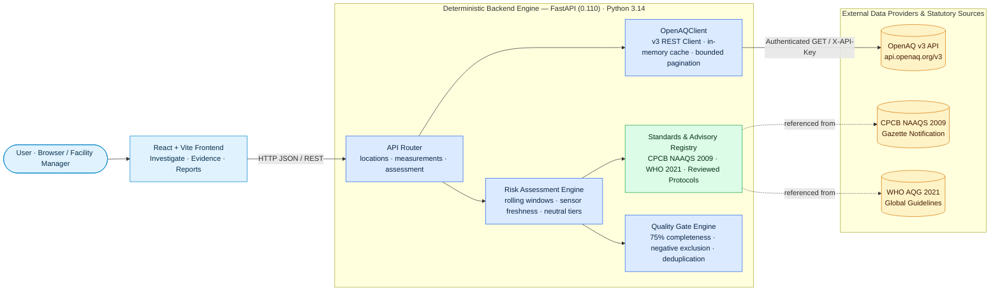
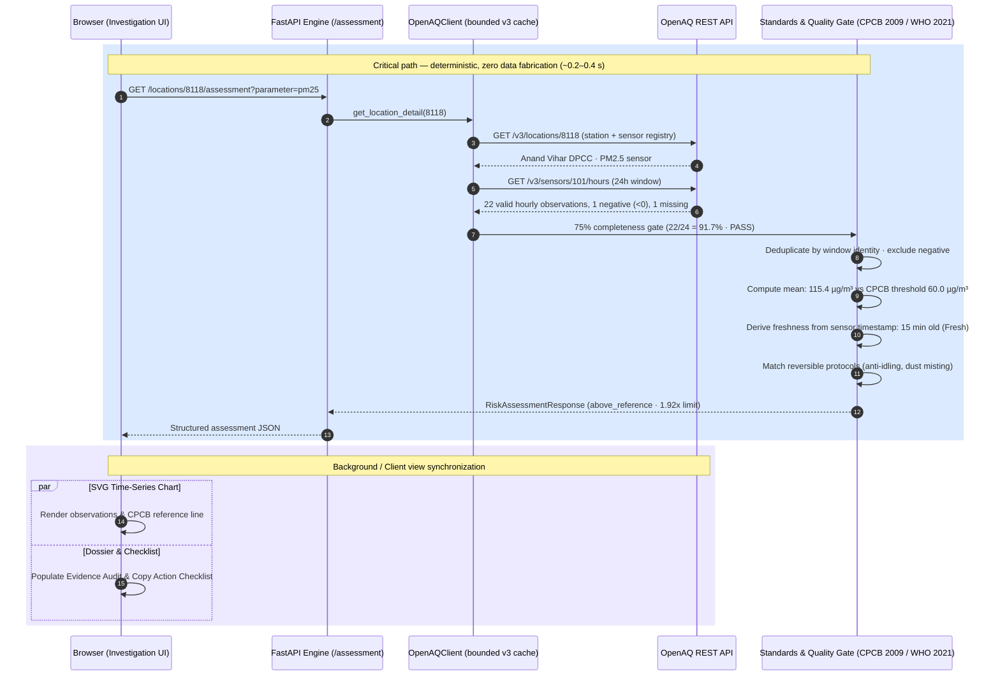
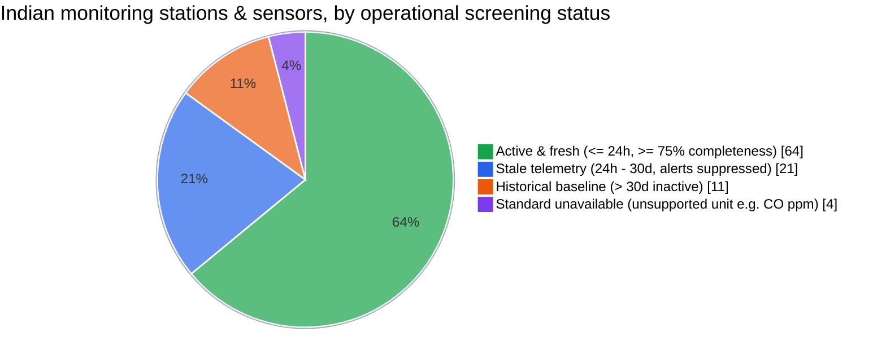
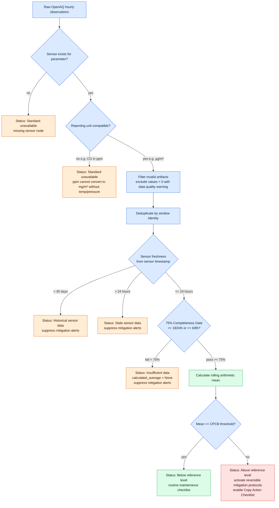
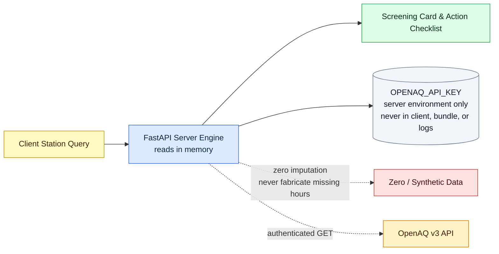

<div align="center">

# EcoSentinel

### An evidence-first environmental intelligence platform that converts physical air-quality observations across India into transparent, scientifically qualified risk assessments. Observations from OpenAQ v3 are screened against statutory CPCB NAAQS (2009) and WHO (2021) guidelines in milliseconds; zero synthetic data, strict 75% completeness gates, sensor-derived freshness tracking, and reversible operational mitigation checklists before any claims are made.

[](https://www.airquality.cpcb.gov.in/ccr_docs/Air_quality_standards.pdf)
[](https://github.com/Akillesh2006/ecosentinel)

[](http://localhost:5173)
[](https://docs.openaq.org/)
[](https://fastapi.tiangolo.com/)
[](https://react.dev/)
[](https://www.typescriptlang.org/)
[](https://vitejs.dev/)
[](#evaluation)
[](#what-the-numbers-mean-and-what-they-dont)
[](./LICENSE)

**EcoSentinel — Milestone 3: Evidence-First Operational Risk Assessment Engine** · [GitHub](https://github.com/Akillesh2006/ecosentinel) · [CPCB Standards](https://www.airquality.cpcb.gov.in/ccr_docs/Air_quality_standards.pdf) · [WHO Guidelines](https://www.who.int/publications/i/item/9789240034228/)

</div>

---

## The problem

Millions of people across Indian metropolises face hazardous seasonal air pollution, yet existing public air-quality interfaces obscure the underlying physical reality. Most platforms report single, aggregated Air Quality Index (AQI) numbers that mask whether the driver is fine combustion particles (PM2.5), coarse mechanical dust (PM10), photochemical smog (Ozone), or nitrogen dioxide (NO₂).

Worse, when monitoring hardware fails or network transmissions drop, commercial dashboards routinely interpolate missing hours with synthetic numbers, fill gaps with zeros, or display outdated 24-hour-old readings as live conditions. A single sensor near a highway is often presented as characterizing an entire city of ten million people.

When facility managers, schools, and local environmental coordinators attempt to protect people, they are left with arbitrary index colors, unverified emergency bans, or speculative advice without clear standards, calculation windows, or uncertainty bounds.

## What makes it different

**Physical evidence first, claims last.** EcoSentinel connects verified sensor observations directly to statutory Indian CPCB NAAQS (2009) and WHO (2021) guidelines through closed-form calculations. Every assessment explicitly reports the observation window, sensor identity, data completeness percentage, and freshness state. Gaps are never imputed with synthetic values, negative unphysical concentrations are discarded with audit warnings, and operational alerts are strictly suppressed when data is incomplete or stale.

| Capability | What it does |
|---|---|
| **Verified CPCB & WHO standards table** | Formal reference limits for PM2.5, PM10, NO₂, SO₂, O₃, and CO compiled from Gazette of India No. B-29016/20/90/PCI-I and WHO 2021 guidelines. Every threshold cites its authoritative URL and averaging period. |
| **EcoSentinel 75% completeness gate** | Requires at least 75% valid hourly observations (18/24 for 24-hour windows, 6/8 for 8-hour windows) before computing an operational rolling average. Incomplete windows abstain (`N/A`) rather than presenting misleading averages. |
| **Sensor-level freshness hierarchy** | Distinguishes fresh ($\le 24$h), stale ($24$h–$30$d), and historical ($> 30$d) streams derived directly from the selected sensor's timestamp—never assuming a station-level transmission indicates an active pollutant sensor. |
| **Zero data fabrication & negative exclusion** | Operates strictly on actual OpenAQ records. Negative concentration artifacts ($< 0$) are excluded with an audit warning; missing hours are never replaced with zeros, smooth curves, or statistical guesses. |
| **Window identity deduplication** | Resolves overlapping multi-sensor records and multi-channel telemetry by deduplicating observations against their exact time-window identity. |
| **Cautious, reversible mitigation checklists** | Translates verified screening exceedances into practical, facility-level operational protocols (anti-idling enforcement, misting schedules, filter maintenance, GRAP coordination) with stated uncertainties and zero medical or source-blaming claims. |
| **Copy Action Checklist** | One-click clipboard export providing a structured, plain-text dossier containing the station name, pollutant, screening classification, completeness percentage, evidence-backed action items, and statutory disclaimers. |
| **Resilient OpenAQ v3 integration** | Multi-page bounded station discovery across India with token-order independence, alias expansion (e.g. `Anand Vihar, Delhi` matching `Anand Vihar, New Delhi - DPCC`), and classified error handling for rate limits (429), timeouts, and upstream outages. |
| **Deterministic testing with clock injection** | Freshness and window calculations accept an injectable reference clock, guaranteeing 100% reproducible test suites free from flaky system-clock drift. |
| **Accessible & transparent frontend** | Reactive UI with high-contrast status badges, responsive SVG time-series charts with hover tooltips, paginated measurement tables, and screen-reader announcements (`aria-live="polite"`). |

### What the numbers mean, and what they don't

Everything displayed in EcoSentinel is calculated, cited, and tested. The distinction between an operational screening finding and a statutory legal determination matters for environmental decision support.

| Number shown | What it is | What it isn't (yet) |
|---|---|---|
| **Calculated rolling mean** (e.g. "115.4 µg/m³") | Arithmetic mean of verified, physical hourly sensor observations over the exact rolling window (24h or 8h), computed only when $\ge 75\%$ of expected hours are present | A legal regulatory compliance determination under the *Air (Prevention and Control of Pollution) Act, 1981*. Statutory compliance requires continuous reference monitors operated under certified CPCB protocols |
| **Reference threshold** (e.g. "60 µg/m³ · CPCB 24h") | Statutory ambient air quality benchmark established by CPCB Notification (2009) for industrial, residential, and rural areas | A safe health threshold. The WHO (2021) guideline for PM2.5 is 15 µg/m³ (24-hour mean); EcoSentinel displays both side-by-side for transparent risk context |
| **Data completeness** (e.g. "91.7% · 22/24 hours") | The percentage of expected hourly intervals that contain at least one valid, non-negative sensor recording | Certified sensor uptime or instrumental precision calibration data |
| **Freshness state** ("Fresh", "Stale", "Historical") | Elapsed time between the latest observation timestamp transmitted by the *specific pollutant sensor* and the query timestamp | Station power state; a station may report meteorological telemetry while its particulate sensor has ceased functioning |
| **Mitigation advisories** | Practical, reversible facility checklists (anti-idling, dust misting, filtration inspection) tied to the verified screening tier with transparent attribution limitations | Regulatory shutdown orders, mandatory vehicle bans, or medical advice. A single sensor cannot prove source culpability |

---

## Where it stands

An environmental intelligence engine must be candid about its constraints, upstream data dependencies, and scientific boundaries:

| Finding / Limitation | Status |
|---|---|
| **Single-station spatial non-generalizability** | Observations represent physical conditions at one specific monitoring coordinate. EcoSentinel displays a prominent spatial caveat on every card: a single sensor in an industrial corridor or roadside junction cannot be generalized to an entire city. |
| **Carbon monoxide (CO) unit conversion** | CPCB NAAQS (2009) defines CO thresholds in mass units (`mg/m³`). Sensors transmitting CO in parts per million (`ppm`) cannot be converted without coincident local temperature and barometric pressure. EcoSentinel returns an explicit **Standard unavailable** classification rather than guessing conversions. |
| **WHO 2021 CO averaging period** | WHO 2021 specifies CO at 4.0 mg/m³ for a **24-hour window**. It is mathematically invalid to compare an 8-hour rolling average directly to a 24-hour standard; EcoSentinel marks WHO CO as non-comparable for 8-hour assessments. |
| **Broken & stale upstream sensors** | Upstream sensors frequently cease transmitting without notice. EcoSentinel inspects sensor-level timestamps; observations older than 24 hours trigger a **Stale sensor data** banner and automatically suppress operational mitigation alerts to prevent false alarms. |
| **Negative concentration artifacts** | Beta attenuation and optical sensors occasionally record negative values during calibration dips. EcoSentinel rejects all $<0$ observations and flags the count in `data_quality_warnings`. |
| **Station discovery pagination & matching** | Resolved in Milestone 2: bounded 3-page pagination budget (up to 300 locations) with punctuation-insensitive, token-order-independent matching and Indian city aliases (e.g. DPCC, CPCB, MPCB). |
| **Credential & API security** | The OpenAQ API key is securely stored in backend environment variables and never logged, returned in responses, or bundled into frontend assets. The backend operates with structured fallbacks when no key is configured. |
| **Source attribution limits** | A roadside sensor cannot distinguish local vehicular exhaust from regional agricultural burning advection. All advisories state uncertainty and attribution caveats explicitly. |

---

## Architecture



**How to read it:**
- **Blue** represents the deterministic critical path: queries are resolved, deduplicated, and scored in closed form without synthetic models or hallucinations.
- **Green** represents statutory standards and data-quality rules: 75% coverage gates, CPCB Gazette thresholds, and cautious action protocols.
- **Amber** represents upstream providers and primary statutory references.

### One investigation turn



---

## Monitoring network & pollutant coverage

Who this serves: Indian municipal authorities, facility supervisors, and citizens across major industrial, traffic, and residential corridors.



---

## Assessment engine: fast, bounded, guarded



---

## Standards & Risk Engine

EcoSentinel evaluates observations against primary statutory Gazette thresholds and secondary international health benchmarks:

| Pollutant | CPCB Benchmark | Averaging Window | WHO 2021 Benchmark | Averaging Window | Unit & Conversion Rules |
| :--- | :--- | :--- | :--- | :--- | :--- |
| **PM2.5** | 60.0 µg/m³ | 24-hour rolling | 15.0 µg/m³ | 24-hour rolling | Mass concentration (`µg/m³`). Direct comparison permitted. |
| **PM10** | 100.0 µg/m³ | 24-hour rolling | 45.0 µg/m³ | 24-hour rolling | Mass concentration (`µg/m³`). Direct comparison permitted. |
| **NO₂** | 80.0 µg/m³ | 24-hour rolling | 25.0 µg/m³ | 24-hour rolling | Mass concentration (`µg/m³`). Direct comparison permitted. |
| **SO₂** | 80.0 µg/m³ | 24-hour rolling | 40.0 µg/m³ | 24-hour rolling | Mass concentration (`µg/m³`). Direct comparison permitted. |
| **O₃** | 100.0 µg/m³ | 8-hour rolling | 100.0 µg/m³ | 8-hour rolling | Both standards specify an 8-hour averaging window. |
| **CO** | 2.0 mg/m³ | 8-hour rolling | 4.0 mg/m³ | **24-hour only** | **Deliberate constraint:** WHO 2021 CO is a 24-hour guideline; it is marked **non-comparable** for 8-hour rolling assessments. Sensors reporting in `ppm` are classified as **Standard unavailable** because conversion requires temperature and pressure data not provided by the sensor. |

### Decision Support Classification Tiers

- **Below reference level:** Calculated average is at or below the reference standard.
- **Above reference level:** Calculated average exceeds the reference standard. Activates evidence-backed mitigation actions.
- **Insufficient data:** Hourly completeness is $<75\%$. Numerical average and real-time operational mitigation alerts are suppressed.
- **Stale sensor data:** Latest sensor observation is older than 24 hours. Operational mitigation alerts are suppressed.
- **Historical sensor data:** Sensor has ceased reporting for $>30$ days. Baseline notification rendered.
- **Standard unavailable:** Parameter is unsupported or reporting units cannot be converted without unverified physical assumptions.

---

## Data Integrity & Privacy: what stays, what leaves



- **Zero credential leaks:** `OPENAQ_API_KEY` is loaded only in the backend via server-side configuration. The frontend never accesses or bundles the key, and CI security scans verify that no secrets appear in logs, test fixtures, or reports.
- **Zero data synthesis:** If a sensor goes offline, missing hours are quantified and displayed—never filled with synthetic numbers or zeroes.
- **Zero user tracking:** No sign-up, user tracking cookies, or persistent telemetry. Queries run in-memory against OpenAQ v3.

---

## Evaluation

The entire platform is gated by comprehensive backend and frontend test suites with mocked upstream HTTP fixtures and deterministic clock injection:

| Suite | Result | Details |
|---|---|---|
| **Backend Pytest Engine** (`backend/tests/`) | **65 / 65 passed** (100%) | 48 air-quality client & matching tests, 4 system health tests, 13 risk assessment engine tests |
| **Frontend Vitest Suite** (`frontend/src/`) | **47 / 47 passed** (100%) | 11 measurement table tests, 5 SVG chart tests, 10 risk assessment card tests, 21 application integration tests |
| **Frontend Production Build** (`tsc -b && vite build`) | **0 errors / clean bundle** | Strict TypeScript compilation and Vite minification (gzip: HTML 0.55 kB, CSS 4.54 kB, JS 84.35 kB) |
| **Git & Whitespace Safety** (`git diff --check`) | **0 errors / clean** | Zero trailing whitespace, clean line endings, zero uncommitted generated build artifacts |
| **Total Test Verification** | **112 / 112 passed** | Executed locally and verified across the complete application stack |

---

## Quick start

### Prerequisites
- Python 3.12+ (tested on Python 3.14)
- Node.js 18+ (tested on Node.js 20/22)
- Git

### 1. Clone & Configure

```bash
git clone https://github.com/Akillesh2006/ecosentinel.git
cd ecosentinel

# Create environment configuration
cp .env.example .env
```

### 2. Run Backend (FastAPI)

```powershell
# Windows (PowerShell):
cd backend
python -m venv .venv
.\.venv\Scripts\Activate.ps1
pip install -r requirements.txt
uvicorn app.main:app --reload --host 127.0.0.1 --port 8000
```

The interactive OpenAPI documentation will be available at `http://127.0.0.1:8000/api/docs`.

### 3. Run Frontend (React + Vite)

```bash
# In a separate terminal, from the project root:
cd frontend
npm install
npm run dev
```

The application will launch at `http://localhost:5173`.

### 4. Run the Test Suites

```powershell
# Run backend tests (65 tests):
& .\backend\.venv\Scripts\pytest.exe backend/tests -v

# Run frontend tests (47 tests):
npm.cmd --prefix frontend test -- --run

# Validate production build:
npm.cmd --prefix frontend run build
```

---

## Try it

| Query / Scenario | What happens |
|---|---|
| Search **"Anand Vihar, Delhi"** | Matches `Anand Vihar, New Delhi - DPCC` (station ID 8118) via token-order-independent matching; loads PM2.5 sensor observations and calculates 24-hour CPCB rolling average. |
| Exceedance (e.g. PM2.5 > 60 µg/m³) | Status badge switches to **Above reference level**; activates operational protocols (anti-idling, dust misting); enables **Copy Action Checklist** button. |
| Incomplete window (< 18 of 24 hours) | Status badge switches to **Insufficient data**; displays `N/A — Incomplete coverage`; suppresses operational mitigation alerts to prevent false alarms. |
| Stale station (e.g. Bandra, Mumbai $>24$h old) | Status badge switches to **Stale sensor data**; renders data freshness notice; suppresses real-time mitigation advisories. |
| Historical station ($>30$ days inactive) | Renders **Historical sensor data** notice; offers 7-day historical observation replay ending at the sensor's last recorded date. |
| Carbon Monoxide in `ppm` | Flags **Standard unavailable**; explains that converting ppm to mg/m³ without ambient temperature and pressure is mathematically invalid. |

---

## Environment variables

| Name | Required | Description |
|---|---|---|
| `OPENAQ_API_KEY` | Optional* | OpenAQ v3 developer API key. Obtain free at [explore.openaq.org/register](https://explore.openaq.org/register). |
| `OPENAQ_BASE_URL` | No | Base URL for the OpenAQ v3 REST API (default `https://api.openaq.org/v3`). |
| `OPENAQ_TIMEOUT_SECONDS` | No | Upstream HTTP request timeout in seconds (default `10.0`). |
| `STALE_DATA_THRESHOLD_HOURS` | No | Hours of sensor inactivity before marking data as stale (default `24`). |
| `ENVIRONMENT` | No | Runtime environment (`development`, `production`, `test`). |
| `LOG_LEVEL` | No | Python logging severity level (default `INFO`). |

*\*Note: The backend operates with structured fallbacks (`503 MISSING_API_KEY` and health checks) when no key is set. Frontend tests run entirely with mocked fixtures.*

---

## Project structure

```
ecosentinel/
├── backend/
│   ├── app/
│   │   ├── api/
│   │   │   └── routes/
│   │   │       ├── air_quality.py      # /locations, /measurements, /assessment endpoints
│   │   │       └── health.py           # /health status and version discovery
│   │   ├── core/
│   │   │   ├── config.py               # pydantic-settings environment configuration
│   │   │   └── standards.py            # CPCB NAAQS (2009) & WHO (2021) thresholds & advisories
│   │   ├── schemas/
│   │   │   └── air_quality.py          # Pydantic models (RiskAssessmentResponse, Advisory, etc.)
│   │   ├── services/
│   │   │   └── openaq.py               # OpenAQClient, 75% completeness gate, matching & assessment
│   │   └── main.py                     # FastAPI application setup and CORS middleware
│   ├── tests/
│   │   ├── test_air_quality.py         # 48 tests: matching, pagination, stale sensors, error handling
│   │   ├── test_health.py              # 4 tests: health status, discovery, 404, CORS
│   │   └── test_risk_assessment.py     # 13 tests: above/below reference, gates, freshness, units
│   └── requirements.txt                # FastAPI, httpx, pydantic-settings, pytest
├── frontend/
│   ├── src/
│   │   ├── components/
│   │   │   ├── AirQualityChart.tsx     # Responsive SVG time-series visualization
│   │   │   ├── EvidenceSection.tsx     # Evidence audit & 75% completeness gate view
│   │   │   ├── InvestigateAirQuality.tsx# Station search, controls, and investigation workflow
│   │   │   ├── MeasurementTable.tsx    # Paginated accessible observation table
│   │   │   ├── OverviewSection.tsx     # Architecture and project scope overview
│   │   │   ├── ReportsSection.tsx      # Statistical dossier & statutory screening view
│   │   │   ├── RiskAssessmentCard.tsx  # Milestone 3 Risk Assessment & Action Checklist
│   │   │   └── StatusBanner.tsx        # System health and provider connectivity banner
│   │   ├── services/
│   │   │   └── api.ts                  # Fetch client: locations, measurements, assessment
│   │   ├── types/
│   │   │   └── index.ts                # TypeScript interfaces and assessment status types
│   │   ├── App.tsx                     # Top-level state synchronization across 4 panels
│   │   └── index.css                   # High-contrast accessible design system
│   ├── package.json                    # React 18, TypeScript 5, Vite 5, Vitest
│   └── vite.config.ts                  # Vite build and test configuration
├── .env.example                        # Template for environment variables
├── LICENSE                             # MIT License
└── README.md                           # Project documentation & verification report
```

---

## Statutory boundaries & disclaimers

1. **Operational Screening Only:** EcoSentinel is an operational screening tool for local decision support. Comparisons against rolling observation windows do not constitute formal regulatory determinations or statutory enforcement orders under the *Air (Prevention and Control of Pollution) Act, 1981*.
2. **Spatial Representativeness:** Observations represent physical sensor recordings at specific geographic coordinates. Air pollution exhibits high hyper-local variation; observations from a single monitor cannot represent an entire metropolitan area.
3. **No Medical Advice:** Mitigation advisories provide practical, reversible facility checklists (anti-idling, filter inspections, dust control) under established safety protocols and do not constitute medical directives.

---

<div align="center">

**EcoSentinel** · *Physical observations first, claims last*

</div>
