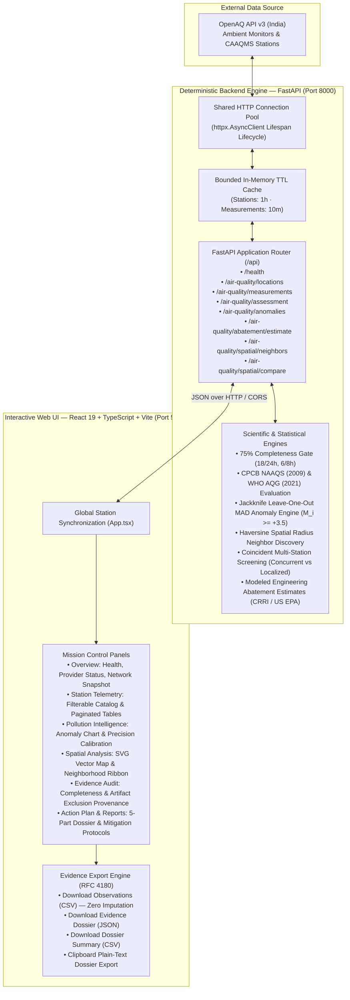

<div align="center">

# EcoSentinel

### Evidence-First Environmental Intelligence & Ambient Anomaly Screening

An open-source environmental intelligence platform that converts physical air-quality observations across India into transparent, scientifically qualified risk assessments and spatial neighborhood screenings. Hourly observations from OpenAQ v3 are compared against statutory Central Pollution Control Board (CPCB NAAQS 2009) benchmarks and referenced against World Health Organization (WHO AQG 2021) guidelines in milliseconds with strict 75% completeness screening gates, robust non-parametric anomaly detection, multi-station spatial synchronization, and modeled operational mitigation dossiers before any claims are made.

[](https://www.airquality.cpcb.gov.in/ccr_docs/Air_quality_standards.pdf)
[](https://github.com/Akillesh2006/ecosentinel)

[](https://docs.openaq.org/)
[](https://fastapi.tiangolo.com/)
[](https://react.dev/)
[](https://www.typescriptlang.org/)
[](https://vitejs.dev/)
[](#testing-and-verification)
[](#scientific-safeguards-and-data-integrity)

**EcoSentinel** · [CPCB Standards](https://www.airquality.cpcb.gov.in/ccr_docs/Air_quality_standards.pdf) · [WHO Guidelines](https://www.who.int/publications/i/item/9789240034228/) · [OpenAQ v3](https://docs.openaq.org/)

### 🌐 [**Live Demo → ecosentinel-9p4g.onrender.com**](https://ecosentinel-9p4g.onrender.com)

*No setup needed. The backend runs on a free tier, so the very first load may take ~30 seconds while it wakes up; live readings appear automatically.*

</div>

---

## The Problem

Millions of people across Indian metropolitan areas face hazardous seasonal air pollution, yet existing public air-quality dashboards obscure the underlying physical reality:

1. **The Single-Number AQI Trap:** Most platforms aggregate multiple pollutants into a single Air Quality Index (AQI) figure that hides whether hazardous levels are driven by fine combustion particles ($\text{PM}_{2.5}$), coarse mechanical dust ($\text{PM}_{10}$), ground-level ozone ($\text{O}_3$), or nitrogen dioxide ($\text{NO}_2$).
2. **Synthetic Zero-Filling & Curve Imputation:** When sensor hardware fails or transmissions drop, consumer dashboards routinely interpolate missing hours with artificial numbers, fill gaps with zeros, or display outdated 24-hour-old readings as live conditions.
3. **Overgeneralized Spatial Representation:** A single monitor near a highway or industrial perimeter is frequently presented as characterizing an entire metropolitan zone of ten million residents.
4. **Unactionable Alarmism:** When facility supervisors, school administrators, and local coordinators attempt to act, they are left with arbitrary color codes, unverified emergency bans, or speculative advice lacking clear statutory baselines, calculation windows, or uncertainty bounds.

---

## Why EcoSentinel is Needed

**Physical evidence first, claims last.** EcoSentinel evaluates open sensor observations against statutory Indian CPCB NAAQS (2009) benchmarks and references WHO (2021) health guidelines through closed-form, deterministic calculations. Every assessment explicitly reports the observation window, sensor identity, data completeness percentage, and freshness state. Gaps are never imputed with synthetic values, negative unphysical concentrations are discarded with audit warnings, and operational alerts are strictly suppressed when data is incomplete or stale.

### Target Users
- **Facility Managers & Fleet Supervisors:** Enforce evidence-backed anti-idling policies, adjust misting schedules, and manage HVAC air intake filtration.
- **Environmental Health & Safety (EHS) Officers:** Generate structured Five-Part Environmental Action Dossiers for corporate and institutional compliance records.
- **Municipal & Regional Environmental Coordinators:** Compare localized station spikes against regional neighborhood baselines to distinguish hyper-local events from regional airshed pollution.
- **Air Quality Researchers & Evaluators:** Export raw, unimputed hourly datasets (RFC 4180 CSV) and complete audit records with full sensor provenance.

---

## Core Features

| Feature | Capability & Implementation |
|---|---|
| **1. Station Telemetry & Time-Series** | Query 100+ Indian monitoring locations indexed via OpenAQ v3 (including government CAAQMS networks where indicated by provider metadata). Inspect hourly observations for $\text{PM}_{2.5}$, $\text{PM}_{10}$, $\text{NO}_2$, $\text{O}_3$, $\text{CO}$, and $\text{SO}_2$ in responsive SVG charts with tooltip inspection and paginated data tables. |
| **2. Pollution Intelligence & Anomaly Screening** | Detect statistical spikes and sensor flatlines using robust Median Absolute Deviation (MAD) and Modified Z-scores ($M_i \ge +3.5$) with Jackknife Leave-One-Out baselines. Immune to extreme outlier distortion and calibrated against diagnostic sensor precision thresholds. |
| **3. Spatial Comparison & Neighbor Discovery** | Discover pollutant-compatible monitoring stations within a configurable Haversine geographic radius (5–50 km). Synchronize coincident time-series across 2 to 5 stations simultaneously (1 reference + up to 4 neighbors). |
| **4. Neighborhood Anomaly Screening** | Classify concurrent regional elevation events versus station-localized spikes on an hourly basis. Evaluates cross-station interquartile ranges (IQR) and computes window-level evaluability metrics with detailed exclusion auditing. |
| **5. Evidence & Sensor Provenance Audit** | Enforce the strict 75% hourly completeness gate (18/24h for 24-hour windows, 6/8h for 8-hour windows). Audit excluded negative measurement artifacts ($< 0$), verify observation timestamps, and track real-world sensor freshness states. |
| **6. Environmental Action Planning** | Generate actionable, five-part operational mitigation dossiers for EHS coordinators with facility checklists (fleet anti-idling, air intake maintenance, dust misting) and modeled engineering abatement estimates (CSIR-CRRI, 2006 IPCC, US EPA). |
| **7. Structured Evidence Exports** | One-click downloadable exports: RFC 4180 compliant CSV for raw unimputed observations (missing values left blank, never 0), structured JSON for the complete Five-Part Dossier, Dossier Summary CSV, and clipboard export. |

---

## Technology Stack

EcoSentinel is designed as a modern, lightweight, stateless platform with zero database overhead:

- **Backend:** Python 3.14 / 3.12+, FastAPI 0.162, Pydantic 2.14, Pydantic-Settings, Uvicorn, HTTPX 0.28 (shared connection pool with lifespan management), Pytest 9.
- **Frontend:** React 19.3, TypeScript ~6.0, Vite 8.3, Vitest 5.0, React Testing Library, Oxlint.
- **Performance & Reliability:** Bounded in-memory thread-safe TTL cache (1 hour for stations, 10 minutes for measurements), shared asynchronous HTTP connection pooling, lazy telemetry fetching, and zero external database dependencies.

---

## System Architecture



---

## Data Source & API Key Requirements

EcoSentinel connects directly to the **OpenAQ v3 programmatic REST API** to retrieve observations from monitoring networks across India (with provider metadata indicating operating organizations such as CPCB, DPCC, or MPCB where available).

- **Authentication:** To query live Indian stations, register for a free API key at [explore.openaq.org/register](https://explore.openaq.org/register) and place it in your `.env` file as `OPENAQ_API_KEY="your_api_key_here"`.
- **Graceful Onboarding:** The backend starts and serves health checks without an API key. If a query is executed without an API key, the backend returns a structured `503 MISSING_API_KEY` response, and the frontend displays a prominent onboarding banner with exact registration instructions.
- **Zero Credential Leaks:** The API key is stored strictly in server-side environment variables and is never exposed in client bundles, network responses, or logs.

---

## Standards & Reference Benchmarks

EcoSentinel evaluates observations against official statutory standards and health benchmarks:

| Pollutant | CPCB NAAQS (2009) Benchmark | Averaging Period | WHO AQG (2021) Guideline | Authority Citation |
|---|---|---|---|---|
| **$\text{PM}_{2.5}$** | $60\ \mu\text{g/m}^3$ | 24-hour rolling | $15\ \mu\text{g/m}^3$ (24h) | Gazette of India No. B-29016/20/90/PCI-I |
| **$\text{PM}_{10}$** | $100\ \mu\text{g/m}^3$ | 24-hour rolling | $45\ \mu\text{g/m}^3$ (24h) | Gazette of India No. B-29016/20/90/PCI-I |
| **$\text{NO}_2$** | $80\ \mu\text{g/m}^3$ | 24-hour rolling | $25\ \mu\text{g/m}^3$ (24h) | Gazette of India No. B-29016/20/90/PCI-I |
| **$\text{SO}_2$** | $80\ \mu\text{g/m}^3$ | 24-hour rolling | $40\ \mu\text{g/m}^3$ (24h) | Gazette of India No. B-29016/20/90/PCI-I |
| **$\text{O}_3$** | $100\ \mu\text{g/m}^3$ | 8-hour rolling | $100\ \mu\text{g/m}^3$ (8h) | Gazette of India No. B-29016/20/90/PCI-I |
| **$\text{CO}$** | $4.0\ \text{mg/m}^3$ | 8-hour rolling | Non-comparable (WHO uses 24h) | Gazette of India No. B-29016/20/90/PCI-I |

> **Scientific Boundary for CO Conversion:** Carbon monoxide in `ppm` is marked **Standard unavailable**. Converting volumetric parts-per-million to mass concentration ($\text{mg/m}^3$) without coincident local barometric pressure and temperature is mathematically invalid; EcoSentinel abstains rather than inventing assumed conversions.

---

## Scientific Safeguards and Data Integrity

1. **Operational Screening Only:** EcoSentinel is an operational screening decision-support tool. An exceedance of a numerical benchmark does **not** constitute a formal statutory violation or legal determination under the *Air (Prevention and Control of Pollution) Act, 1981*.
2. **Spatial Representativeness:** Observations represent physical sensor recordings at specific geographic coordinates. Air pollution exhibits extreme hyper-local microclimates; a single monitor cannot represent an entire city.
3. **Strict 75% Completeness Gate:** At least 75% of expected hourly intervals (18/24 for 24h, 6/8 for 8h) must contain valid non-negative readings as an operational data quality screening threshold. This gate serves as quality assurance and does not constitute a formal regulatory certification. If coverage falls below 75%, operational averages and mitigation alerts are strictly suppressed (`N/A`).
4. **Zero Data Imputation:** Missing hours are never filled with zeros, interpolated curves, or statistical guesses. In exports, missing observation values remain empty cells.
5. **Separation of Measurements & Estimates:** Ambient observations represent physical readings reported by monitoring stations. Abatement metrics (fuel saved, $\text{CO}_2$, $\text{NO}_x$, $\text{PM}_{2.5}$ avoided) are modeled engineering estimates based on established planning factors (CSIR-CRRI, 2006 IPCC, US EPA), and must never be conflated with measured ambient concentration reductions.
6. **No Fake Demo Data:** Offline demo snapshots are intentionally omitted to prevent unverified synthetic data from masquerading as authentic physical observations.

---

## Quick Start & Local Execution

### Prerequisites
- **Python:** 3.12 or higher (tested on Python 3.14)
- **Node.js:** 18 or higher (tested on Node.js 20/22)
- **Git**

### 1. Clone & Configure Environment

```powershell
git clone https://github.com/Akillesh2006/ecosentinel.git
cd ecosentinel

# Copy environment configuration template
Copy-Item .env.example .env
```

Open `.env` in an editor and insert your OpenAQ API key:
```dotenv
OPENAQ_API_KEY="your_openaq_api_key_here"
```

### 2. Start the FastAPI Backend

```powershell
# In PowerShell:
cd backend
python -m venv .venv
.\.venv\Scripts\Activate.ps1
pip install -r requirements.txt
uvicorn app.main:app --reload --host 127.0.0.1 --port 8000
```

The interactive OpenAPI documentation will be accessible at `http://127.0.0.1:8000/api/docs`.

### 3. Start the Vite Frontend

```powershell
# In a separate PowerShell terminal, from the project root:
cd frontend
npm.cmd install
npm.cmd run dev
```

*Note: On Windows PowerShell, use `npm.cmd` to avoid PowerShell script execution policy restrictions on `npm.ps1`.*

The web application will launch at `http://localhost:5173`.

---

## Testing and Verification

EcoSentinel is protected by automated unit and component/endpoint test suites with deterministic clock injection and upstream mock fixtures:

| Test Suite | Command | Result | Verified Capabilities |
|---|---|---|---|
| **Backend (Pytest)** | `backend\.venv\Scripts\python.exe -m pytest backend/tests -q` | **157 / 157 passed** (100%) | Client matching, 75% completeness gate, CPCB/WHO standards, Jackknife MAD anomalies, spatial Haversine discovery, neighborhood screening, TTL caching, lifecycle pooling |
| **Frontend (Vitest)** | `npm.cmd --prefix frontend test -- --run` | **150 / 150 passed** (100%) | Global station sync, lazy fetching, SVG charts, paginated tables, spatial maps, neighborhood ribbons, evidence exports, RFC 4180 escaping |
| **Linter (Oxlint)** | `npm.cmd --prefix frontend run lint` | **0 errors** (27 warnings) | Syntax validation, hook dependencies, and code hygiene |
| **Production Build** | `npm.cmd --prefix frontend run build` | **Clean Bundle** (0 errors) | Strict TypeScript compilation (`tsc -b`) and minified Vite bundle generation |

---

## Environment Variables Reference

| Variable | Default Value | Required | Description |
|---|---|---|---|
| `OPENAQ_API_KEY` | `""` | Recommended | OpenAQ v3 developer API key from [explore.openaq.org/register](https://explore.openaq.org/register). |
| `OPENAQ_BASE_URL` | `https://api.openaq.org/v3` | No | Base URL for OpenAQ REST API v3. |
| `OPENAQ_TIMEOUT_SECONDS` | `10.0` | No | Timeout for upstream requests in seconds. |
| `STALE_DATA_THRESHOLD_HOURS` | `24` | No | Inactivity threshold before flagging sensor as stale. |
| `HOST` | `127.0.0.1` | No | Host address for local FastAPI server. |
| `PORT` | `8000` | No | Port for local FastAPI server. |
| `CORS_ORIGINS` | `["http://localhost:5173", "http://127.0.0.1:5173"]` | No | Authorized CORS origins for frontend communication. |
| `VITE_API_BASE_URL` | `http://localhost:8000` | No | Base URL consumed by the Vite frontend API client. |

---

## Project Structure

```
ecosentinel/
├── backend/
│   ├── app/
│   │   ├── api/
│   │   │   └── routes/
│   │   │       ├── air_quality.py         # Endpoints: locations, measurements, assessment, anomalies, spatial
│   │   │       └── health.py              # /health status, version, and milestone reporting
│   │   ├── core/
│   │   │   ├── config.py                  # Pydantic-Settings environment configuration
│   │   │   ├── spatial.py                 # Haversine distance, coordinate validation, spatial metrics
│   │   │   └── standards.py               # CPCB NAAQS (2009) & WHO (2021) benchmarks & advisories
│   │   ├── schemas/
│   │   │   ├── air_quality.py             # Pydantic models (LocationDetail, RiskAssessment, etc.)
│   │   │   └── spatial.py                 # Spatial schemas (NeighborsResponse, ScreeningSummary, etc.)
│   │   ├── services/
│   │   │   ├── openaq.py                  # OpenAQClient, 75% gate, Jackknife MAD anomalies, TTL cache
│   │   │   └── spatial.py                 # Spatial discovery, parallel multi-station retrieval, screening
│   │   └── main.py                        # FastAPI application lifespan, CORS, and router registration
│   ├── tests/
│   │   ├── conftest.py                    # Shared pytest fixtures
│   │   ├── test_air_quality.py            # OpenAQ integration, matching, pagination, negative exclusion
│   │   ├── test_health.py                 # Health endpoint, CORS headers, error responses
│   │   ├── test_openaq_cache_and_lifecycle.py # Thread-safe TTL cache & connection pooling tests
│   │   ├── test_risk_assessment.py        # 75% gate, rolling means, freshness, parameter validation
│   │   └── test_spatial_screening.py      # Haversine distance, neighborhood screening, concurrence
│   └── requirements.txt                   # Backend dependencies
├── frontend/
│   ├── src/
│   │   ├── components/
│   │   │   ├── AirQualityChart.tsx        # Responsive SVG time-series visualization
│   │   │   ├── AnomalyEvidencePanel.tsx   # Anomaly statistics, baseline MAD, precision limits
│   │   │   ├── AnomalySection.tsx         # Anomaly screening dashboard & calibration controls
│   │   │   ├── ApiKeyMissingBanner.tsx    # Uniform API-key onboarding banner
│   │   │   ├── EnvironmentalActionPlan.tsx# Facility Action Dossier, anti-idling, dust checklists
│   │   │   ├── EvidenceSection.tsx        # Data completeness audit & unimputed CSV export
│   │   │   ├── InvestigateAirQuality.tsx  # Station search, controls, and active catalog discovery
│   │   │   ├── MeasurementTable.tsx       # Accessible paginated observation table
│   │   │   ├── NeighborhoodScreeningEvidenceCard.tsx # Coincident neighborhood screening details
│   │   │   ├── NeighborhoodScreeningRibbon.tsx       # Regional vs localized status indicator
│   │   │   ├── OverviewSection.tsx        # Mission control overview & active station snapshot
│   │   │   ├── ReportsSection.tsx         # Statistical profile & structured evidence export toolbar
│   │   │   ├── RiskAssessmentCard.tsx     # CPCB/WHO screening finding & operational advisories
│   │   │   ├── Sidebar.tsx                # Accessible navigation sidebar
│   │   │   ├── SpatialComparisonMap.tsx   # Interactive SVG multi-station dispersion vector map
│   │   │   ├── SpatialSection.tsx         # Multi-station comparison & Haversine radius discovery
│   │   │   └── StatusBanner.tsx           # Backend health and provider connectivity banner
│   │   ├── services/
│   │   │   └── api.ts                     # Fetch client with structured error mapping & HTTP status
│   │   ├── types/
│   │   │   └── index.ts                   # Complete TypeScript interfaces for air quality & spatial models
│   │   ├── utils/
│   │   │   ├── exportEvidence.ts          # RFC 4180 CSV & structured JSON export generators
│   │   │   └── exportEvidence.test.ts     # Unit tests for evidence export, escaping, and disclaimers
│   │   ├── App.tsx                        # Global state synchronization across all 6 panels
│   │   └── index.css                      # High-contrast accessible design tokens & utility classes
│   ├── package.json                       # React 19, TypeScript ~6.0, Vite 8, Vitest 5
│   └── vite.config.ts                     # Vite & Vitest configuration with jsdom
├── .env.example                           # Clean environment template
├── .gitignore                             # Git ignore rules (secrets, venv, node_modules)
└── README.md                              # Project documentation & verification report
```

---

## License & Attribution

- **License Status:** The project is intended as open-source environmental software. For hackathon submission and open-source evaluation, the recommended license is the **MIT License** (permissive, allowing evaluation, distribution, and research with standard disclaimer of warranty). In accordance with licensing safety protocols, no license file is created without explicit author instruction.
- **Data Attribution:** Environmental observations courtesy of the **OpenAQ programmatic platform** and participating Indian monitoring agencies (such as Central Pollution Control Board, Delhi Pollution Control Committee, and Maharashtra Pollution Control Board, where indicated by provider metadata).
- **Engineering Factors:** Idling emission factors derived from Central Road Research Institute (CSIR-CRRI) in-use commercial vehicle studies, 2006 IPCC Guidelines for National Greenhouse Gas Inventories, and US EPA documentation (EPA420-F-08-025). Fugitive dust control benchmarks cite US EPA AP-42 §13.2.2. Modeled factors represent planning assumptions and engineering estimates rather than measured on-site tailpipe or ambient concentration reductions.

---

<div align="center">

**EcoSentinel** · *Physical observations first, claims last*

</div>
